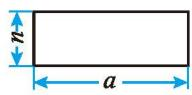
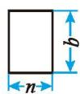
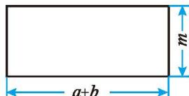

# 长方形卡片拼图与因式分解等式探究

## 北师大版初中数学·八年级下册

> [!question] 尝试·思考
> 如图 4-1，有三张不同型号的长方形卡片。
>
> (1) 你能选择其中两张卡片拼成一个长方形吗?
>
> (2) 你能用这三张卡片拼成一个长方形吗?
>
> (3) 依据 (1)(2) 拼图的过程及结果, 你能写出哪些多项式的因式分解? 你是怎样想的?
>
> 
>
> ①
>
> 
>
> ②
>
> 图4-1
>
> 
>
> ③

