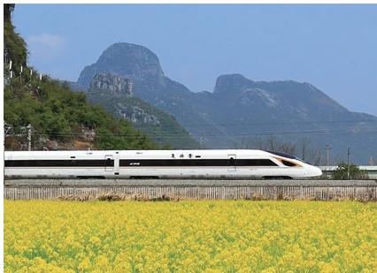
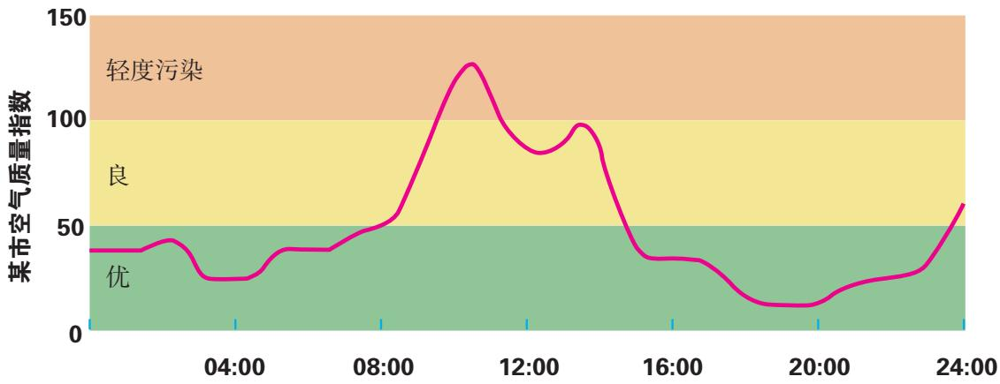

问题 1 某“复兴号”高速列车加速到 $350\ \mathrm{km/h}$ 后保持匀速运行半小时。这段时间内，列车行进的路程 $s$（单位：$\mathrm{km}$）与运行时间 $t$（单位：$\mathrm{h}$）的关系可以表示为

$$
s = 350t.
$$

思考：有人说：“根据对应关系 $s = 350t$ ，这趟列车加速到 $350\ \mathrm{km/h}$ 后，运行 $1\ \mathrm{h}$ 就前进了 $350\ \mathrm{km}$ 。”你认为这个说法正确吗？

问题 2 某电气维修公司要求工人每周工作至少 1 天，至多 6 天。如果公司确定的工资标准是每人每天 350 元，而且每周付一次工资，那么你认为该怎样确定一个工人每周的工资？一个工人的工资 $w$（单位：元）是他工作天数 $d$ 的函数吗？

问题 3 图 3.1-1 是某市某日的空气质量指数（Air Quality Index，简称 AQI）变化图。如何根据该图确定这一天内任一时刻 $t\ \mathrm{h}$ 的空气质量指数（AQI）的值 $I$ ？你认为这里的 $I$ 是 $t$ 的函数吗？你能根据图 3.1-1 找到中午 12 时的 AQI 的值吗？

  
图3.1-1

问题 4 国际上常用恩格尔系数 $r\left(r=rac{	ext{食物支出金额}}{	ext{总支出金额}}	imes100\%
ight)$ 反映一个地区人民生活质量的高低，恩格尔系数越低，生活质量越高。表 3.1-1 是我国城镇居民恩格尔系数变化情况。

表 3.1-1 我国城镇居民恩格尔系数变化情况

<table><tr><td>年份 y</td><td>2012</td><td>2013</td><td>2014</td><td>2015</td><td>2016</td><td>2017</td><td>2018</td><td>2019</td><td>2020</td><td>2021</td></tr><tr><td>恩格尔系数 r(%)</td><td>32.0</td><td>30.1</td><td>30.0</td><td>29.7</td><td>29.3</td><td>28.6</td><td>27.7</td><td>27.6</td><td>29.2</td><td>28.6</td></tr></table>

你认为按表 3.1-1 给出的对应关系，恩格尔系数 $r$ 是年份 $y$ 的函数吗？如果是，你会用怎样的语言来刻画这个函数？

上述问题 1～问题 4 中的函数有哪些共同特征？由此你能概括出函数概念的本质特征吗？
