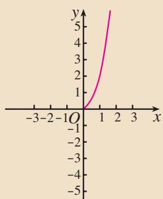

思考

(1) 判断函数 $f(x)=x^{3}+x$ 的奇偶性.

(2) 图 3.2-9 是函数 $f(x) = x^3 + x$ 图象的一部分，你能根据 $f(x)$ 的奇偶性画出它在 $y$ 轴左边的图象吗？

（3）一般地，如果知道 $y = f(x)$ 为偶（奇）函数，那么我们可以怎样简化对它的研究？

  
图3.2-9

## 本节相关知识（范围关联）

- [偶函数](../%E7%9F%A5%E8%AF%86%E7%82%B9/%E7%9F%A5%E8%AF%86%E7%82%B9-%E5%81%B6%E5%87%BD%E6%95%B0.md)
- [奇函数](../%E7%9F%A5%E8%AF%86%E7%82%B9/%E7%9F%A5%E8%AF%86%E7%82%B9-%E5%A5%87%E5%87%BD%E6%95%B0.md)
