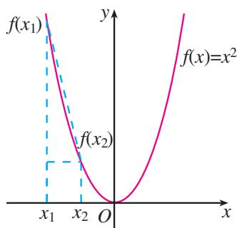

# 思考：随自变量增大函数值的变化趋势

在初中，我们利用函数图象研究过函数值随自变量的增大而增大（或减小）的性质，这一性质叫做函数的单调性。下面进一步用符号语言刻画这种性质。

先研究二次函数 $f(x)=x^{2}$ 的单调性.

画出它的图象（如图3.2-2），可以看到：

图象在 $y$ 轴左侧部分从左到右是下降的，也就是说，当 $x \leqslant 0$ 时， $y$ 随 $x$ 的增大而减小。用符号语言描述，就是任意取 $x_1, x_2 \in (-\infty, 0]$ ，得到 $f(x_1) = x_1^2, f(x_2) = x_2^2$ ，那么当 $x_1 < x_2$ 时，有 $f(x_1) > f(x_2)$ 。这时我们就说函数 $f(x) = x^2$ 在区间 $(- \infty, 0]$ 上是单调递减的。

图3.2-2

图象在 $y$ 轴右侧部分从左到右是上升的，也就是说，当

你能说明为什么 $f(x_{1}) > f(x_{2})$ 吗？

$x \geqslant 0$ 时， $y$ 随 $x$ 的增大而增大。用符号语言表达，就是任意取 $x_1, x_2 \in [0, +\infty)$ ，得到 $f(x_1) = x_1^2, f(x_2) = x_2^2$ ，那么当 $x_1 < x_2$ 时，有 $f(x_1) < f(x_2)$ 。这时我们就说函数 $f(x) = x^2$ 在区间 $[0, +\infty)$ 上是单调递增的。

你能说明为什么 $f(x_{1}) < f(x_{2})$ 吗？

思考

函数 $f(x)=|x|$ ， $f(x)=-x^{2}$ 各有怎样的单调性？

## 引出的知识

- [函数的单调性](../%E7%9F%A5%E8%AF%86%E7%82%B9/%E7%9F%A5%E8%AF%86%E7%82%B9-%E5%87%BD%E6%95%B0%E7%9A%84%E5%8D%95%E8%B0%83%E6%80%A7.md)

## 本节相关知识（范围关联）

- [函数的单调性](../%E7%9F%A5%E8%AF%86%E7%82%B9/%E7%9F%A5%E8%AF%86%E7%82%B9-%E5%87%BD%E6%95%B0%E7%9A%84%E5%8D%95%E8%B0%83%E6%80%A7.md)

## 所属组织

- [函数的单调性](../%E7%9F%A5%E8%AF%86%E4%B8%B2%E8%81%94/%E4%BA%BA%E6%95%99A-%E5%BF%85%E4%BF%AE%E7%AC%AC%E4%B8%80%E5%86%8C/%E6%95%99%E6%9D%90%E9%97%AE%E9%A2%98%E9%A1%BA%E5%BA%8F/%E7%AC%AC%E4%B8%89%E7%AB%A0%20%E5%87%BD%E6%95%B0%E7%9A%84%E6%A6%82%E5%BF%B5%E4%B8%8E%E6%80%A7%E8%B4%A8/3.2%20%E5%87%BD%E6%95%B0%E7%9A%84%E5%9F%BA%E6%9C%AC%E6%80%A7%E8%B4%A8/3.2.1%20%E5%8D%95%E8%B0%83%E6%80%A7%E4%B8%8E%E6%9C%80%E5%A4%A7%28%E5%B0%8F%29%E5%80%BC/%E5%87%BD%E6%95%B0%E7%9A%84%E5%8D%95%E8%B0%83%E6%80%A7.md)
