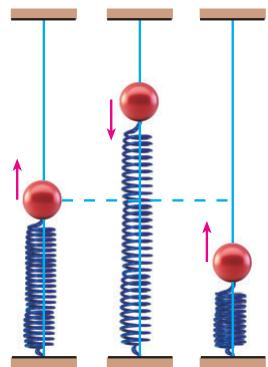

问题

某个弹簧振子（简称振子）在完成一次全振动的过程中，时间 $t$ （单位：$\mathrm{s}$ ）与位移 $y$ （单位：$\mathrm{mm}$ ）之间的对应数据如表 5.7-1 所示。试根据这些数据确定这个振子的位移关于时间的函数解析式。

表5.7-1

<table><tr><td>t</td><td>0.00</td><td>0.05</td><td>0.10</td><td>0.15</td><td>0.20</td><td>0.25</td><td>0.30</td><td>0.35</td><td>0.40</td><td>0.45</td><td>0.50</td><td>0.55</td><td>0.60</td></tr><tr><td>y</td><td>-20.0</td><td>-17.8</td><td>-10.1</td><td>0.1</td><td>10.3</td><td>17.7</td><td>20.0</td><td>17.7</td><td>10.3</td><td>0.1</td><td>-10.1</td><td>-17.8</td><td>-20.0</td></tr></table>
