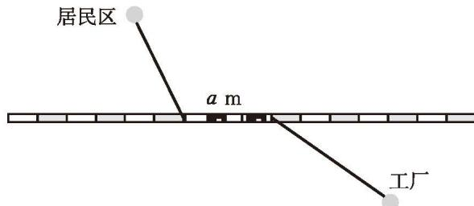

# 问题解决活动：最短距离探究问题

## 北师大版初中数学·八年级下册

问题 如图 3-32, 居民区和工厂分别在一条城铁线路的南、北两侧, 现要沿着城铁线路修建一条地下通道, 居民区的居民经过该地下通道去工厂上班。已知该地下通道长度为 $a \mathrm{~m}$ ,

那么地下通道的两个出入口应该设计在何处，才能使居民经过该地下通道去工厂上班的路线最短？请画出这条最短路线并说明理由（不考虑地面到地下通道地面的高度）。

图3-32

上述问题可以抽象成怎样的数学问题？试着写一写、画一画。

(1) 你以前遇到过类似的问题吗?

(2) 解决这个问题最大的困难是什么?

(3) 地下通道将居民区到工厂的路从中间分成了两段, 你能设法将居民区、通道或工厂 “移动” 位置, 让前后两段路连起来吗?

(1) 写出你的解决方案。

(2) 说明你的方案的合理性。

通过解决上述问题，你获得了哪些经验？你认为解决这类问题的关键是什么？

