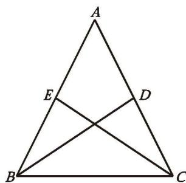

问题 证明：等腰三角形两腰上的中线相等。

已知：如图 1-41，在 $\triangle ABC$ 中，AB = AC，BD 和 CE 分别是边 AC，AB 上的中线。

求证：BD=CE。

已知条件是什么？目标是什么？将条件标注到图形中，你发现了哪些相等关系？

图1-41

(1) 证明两条线段相等有哪些常用的方法?

(2) 以 $BD$ 为边的三角形有哪些? 以 $CE$ 为边的三角形呢? 其中哪些三角形有可能全等?

(3) 找出两个有可能全等的三角形, 要证明这两个三角形全等, 已知哪些边或角相等? 还需要证明哪些边或角相等?

(4) 整理你的思路，并与同伴进行交流。

按照下述思路写出证明过程，并说明每一步的理由。

(1)通过 $\triangle ABD\cong\triangle ACE$ ，证明 BD=CE。

(2)通过 $\triangle CBD\cong\triangle BCE$ ，证明 $BD=CE$ 。

(1) 比较两种证明方法, 你更喜欢哪种方法? 说说你的理由。

(2) 根据题目的条件, 你还能得到哪些结论? 与同伴进行交流。

(3) 适当改变题目的条件, 你还能得到哪些结论?

(4) 本题证明了等腰三角形两腰上的中线相等。反过来, 如果一个三角形两边上的中线相等, 那么这个三角形是等腰三角形吗?

(5) 你认为还可以研究哪些问题？与同伴进行交流。
