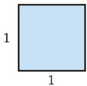
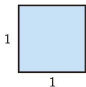

# 面积为2的正方形边长剪拼探究引出非有理数的存在

## 北师大版初中数学·八年级上册

图 2-1 中是两个边长为 1 的小正方形，剪一剪、拼一拼，设法得到一个大的正方形。

(1) 设大正方形的边长为 $a, a$ 满足什么条件?

(2) $a$ 可能是整数吗？说说你的理由。

图2-1

(3) $a$ 可能是分数吗? 说说你的理由, 并与同伴进行交流。

事实上，满足等式 $a^2 = 2$ 的 $a$ 既不是整数，也不是分数，所以 $a$ 不是有理数。

