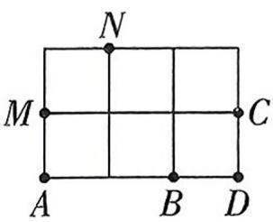
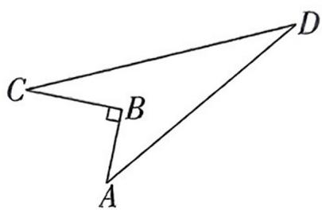

<!-- question-source:start -->
8[2025 陕西咸阳质检]如图,在小正方形组成的 $3 \times 2$ 网格中,每个小正方形的顶点称为格点.点 $A, B, C, D, M, N$ 均在格点上,其中能与点 $M, N$ 构成一个直角三角形的是 ( ) A. 点 $A$ B. 点 $B$ C. 点 $C$ D. 点 $D$

(第8题图)

(第9题图)
<!-- question-source:end -->

![[Q00105095A1]]
