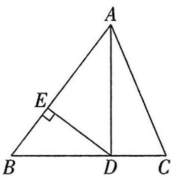
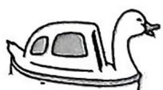

<!-- question-source:start -->
10[2025 四川成都质检]如图,小区有一块三角形空地 $ABC$ ,计划将这块空地种上三种不同的花卉,中间用小路 $AD, DE$ 隔开(小路宽度忽略不计), $DE \perp AB$ . 经测量, $AB = 15$ 米, $AC = 13$ 米, $AD = 12$ 米, $DC = 5$ 米.

(1)求 $BD$ 的长;

(2)若铺设小路 $AD, DE$ 每米需 30 元, 则需花费多少?

轻舟已过万重山了鸭
<!-- question-source:end -->

![[Q00105097A1]]
