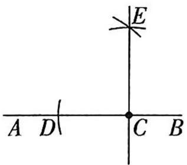
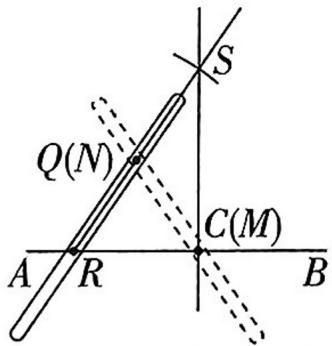

<!-- question-source:start -->
2 新考法[2025 山西晋中质检, 中]老师布置了任务: 过直线 $AB$ 上一点 $C$ 作 $AB$ 的垂线. 在没有直角尺的情况下, 嘉嘉和淇淇给出了如下两种方案, 下列判断正确的是 ( )

<table><tr><td>方案I:如图.1利用一把有刻度的直尺在AB上量出CD=30cm.2分别以D,C为圆心,以50cm和40cm为半径画弧交于点E.3作直线CE,CE即为AB的垂线</td><td>方案II:如图,取一根笔直的木棒,在木棒上标出M,N两点.1使点M与点C重合,点N对应的位置标记为点Q.2保持点N不动,将木棒绕点N旋转,使点M落在AB上的R点处.3将RQ延长,在延长线上截取线段QS=MN,得到点S.4作直线SC,SC即为AB的垂线</td></tr></table>

A. I 可行, II 不可行
B. I 不可行, II 可行
C. I, II 都不可行
D. I, II 都可行
<!-- question-source:end -->

![[Q00105100A1]]
