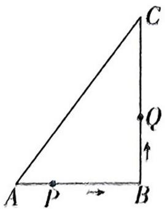
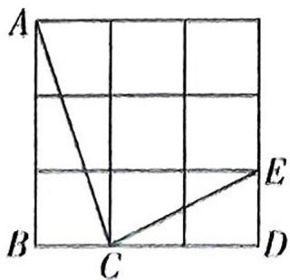

<!-- question-source:start -->
3[2024 湖北武汉调研, 中]如图所示, 在 $\triangle ABC$ 中, $AB:BC:CA=3:4:5$ , 且周长为 $36 \mathrm{~cm}$ , 点 $P$ 从点 $A$ 出发沿 $AB$ 边向 $B$ 点以 $1 \mathrm{~cm/s}$ 的速度移动, 点 $Q$ 从点 $B$ 出发沿 $BC$ 边向点 $C$ 以 $2 \mathrm{~cm/s}$ 的速度移动. 若 $P, Q$ 两点同时出发, 则 $3 \mathrm{~s}$ 时, $\triangle BPQ$ 的面积为 $\_ \_ \_ \_ \_ \_ \_ \_ \_ \_ \_ \_ \_ \_ \_ \_ \_ \_ \_ \_ \_ \_ \_ \_ \_ \_ \_ \_ \_ \_ \_ \_ \_ \_ \_ \_ \_ \_ \_ \_ \_ \_ \_ \_ \_ \_ \_ \_ \_ \_ \_ =$

(第3题图)

(第4题图)
<!-- question-source:end -->

![[Q00105101A1]]
