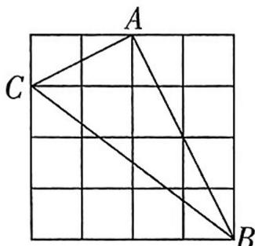

<!-- question-source:start -->
2[2024 山东济南槐荫区调研]如图,在 $4 \times 4$ 的网格中,每个小正方形的边长均为 1 ,点 $A, B, C$ 都在格点上,则下列结论错误的是 ( )

A. $BC = 5$ B. $\angle BAC = 90^{\circ}$ C. $\triangle ABC$ 的面积为 10
D. 点 $A$ 到直线 $BC$ 的距离是 2

<!-- question-source:end -->

![[Q00105787A1]]
