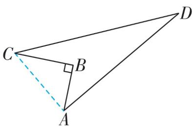

> [!success]- 必刷题
>
> > [!success] **【答案】** D
>
> > [!note]- **【解析】**
> > 设题图中每个小正方形的边长均为 1. A 选项, 连接 $MN, AN$ , 因为 $AM^{2} = 1^{2} = 1$ , $MN^{2} = 1^{2} + 1^{2} = 2$ , $AN^{2} = 1^{2} + 2^{2} = 5$ , 所以 $AM^{2} +$
> >
> > $MN^2 \neq AN^2$ ，所以 $\triangle AMN$ 不是直角三角形，故 A 不符合题意；B 选项，连接 $BM, BN, MN$ ，因为 $MN^2 = 1^2 + 1^2 = 2, MB^2 = 1^2 + 2^2 = 5, BN^2 = 1^2 + 2^2 = 5$ ，所以 $MN^2 + MB^2 \neq BN^2$ ，所以 $\triangle BMN$ 不是直角三角形，故 B 不符合题意；C 选项，连接 $MN, CN$ ，因为 $MN^2 = 1^2 + 1^2 = 2, CN^2 = 1^2 + 2^2 = 5, MC^2 = 3^2 = 9$ ，所以 $MN^2 + CN^2 \neq MC^2$ ，所以 $\triangle CMN$ 不是直角三角形，故 C 不符合题意；D 选项，连接 $DM, DN, MN$ ，因为 $MN^2 = 1^2 + 1^2 = 2, MD^2 = 1^2 + 3^2 = 10, DN^2 = 2^2 + 2^2 = 8$ ，所以 $MN^2 + DN^2 = MD^2$ ，所以 $\triangle DMN$ 是直角三角形，故 D 符合题意。故选 D。
> >
> > $$
> > A B = 3 \mathrm{m}
> > $$
> >
> > $$
> > B C = 4 \mathrm{m}, \angle A B C =
> > $$
> >
> > 
> >
> > $90^{\circ}$ , 所以由勾股定理 $\vec{A}$ 得 $AC^{2} = BC^{2} + AB^{2} = 25$ , 所以 $AC = 5 \mathrm{~m}$ . 因为 $CD = 13 \mathrm{~m}, AD = 12 \mathrm{~m}$ , 所以 $AC^{2} + AD^{2} = 5^{2} + 12^{2} = 13^{2} = CD^{2}$ , 所以 $\triangle CAD$ 是直角三角形, $\angle CAD = 90^{\circ}$ , 所以这块土地的面积为 $S_{\triangle CAD} - S_{\triangle CAB} = \frac{1}{2} CA \cdot AD - \frac{1}{2} BC \cdot AB = \frac{1}{2} \times 5 \times 12 - \frac{1}{2} \times 3 \times 4 = 24 (\mathrm{~m}^{2})$ . 故答案为 24.
