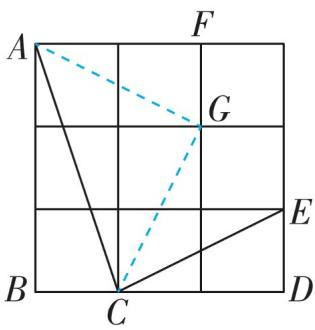

> [!success]- 必刷题
>
> > [!success] **【答案】** 18
>
> > [!note]- **【解析】**
> > 设 AB 为 3x cm, BC 为 4x cm, AC 为 5x cm. 因为周长为 36 cm, 所以 $AB + BC + AC = 36 \, cm$ , 所以 $3x + 4x + 5x = 36$ , 解得 x = 3, 所以 AB = 9 cm, BC = 12 cm, AC = 15 cm. 因为 $AB^{2} + BC^{2} = AC^{2}$ , 所以 $\triangle ABC$ 是直角三角形. 3 s 时, $BP = 9 - 3 \times 1 = 6 \, (\text{cm})$ , $BQ = 2 \times 3 = 6 \, (\text{cm})$ , 所以 $S_{\triangle PBQ} = \frac{1}{2}BP \cdot BQ = \frac{1}{2} \times 6 \times 6 = 18 \, (\text{cm}^{2})$ . 故答案为 18.
> >
> > 4.45 【解析】如图,标出点 G, 连接 CG, AG. 由勾股定理得 $AG^{2} = CG^{2} = 1^{2} + 2^{2} = 5$ , $AC^{2} = 1^{2} + 3^{2} = 10$ , 则 $AG^{2} + CG^{2} = AC^{2}$ , 所以 $\triangle CAG$ 是等
> >
> > 
> >
> > 腰直角三角形, $\angle CGA = 90^{\circ}$ , 所以 $\angle CAG = 45^{\circ}$ . 因为 $AF \parallel BC$ , 所以 $\angle CAF = \angle BCA$ . 在 $\triangle AFG$ 和 $\triangle CDE$ 中, $\left\{ \begin{array}{l} AF = CD, \\ \angle AFG = \angle CDE = 90^{\circ}, \\ FG = DE, \end{array} \right.$ 所以 $\triangle AFG \cong \triangle CDE$ (SAS), 所以 $\angle FAG = \angle DCE$ , 所以 $\angle ACB - \angle DCE = \angle CAF - \angle FAG = \angle CAG = 45^{\circ}$ . 故答案为 45.
