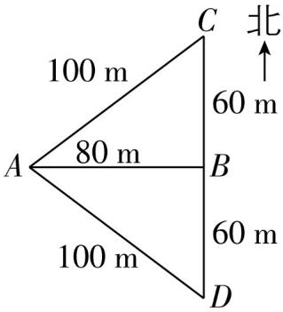

> [!success]- 必刷题
>
> > [!success] **【答案】** D
>
> > [!note]- **【解析】**
> > 如图, 设小明初始位置在 A 处, 根据题意知 $AB = 80 \, m, BC = BD = 60 \, m, AC = AD = 100 \, m$ . 根据 $60^{2} + 80^{2} = 100^{2}$ , 得 $\angle ABC = \angle ABD = 90^{\circ}$ , 故小明向东走 $80 \, m$ 后, 又向北或向南走了 $60 \, m$ . 故选 D.
> >
> > 思路分析设AB为3x cm, BC为4x cm, AC为5x cm, 根据△ABC的周长为36 cm 列方程并求出三角形的三边长, 逆用勾股定理得出△ABC为直角三角形, 再求出3 s时, BP, BQ的长, 利用三角形的面积公式计算求解即可.
> >
> >
> > 
> >
> > 思路分析
> > (2) 设 BN = x，
> > 则 MN = AB - AM - BN = 7 - x，分两种情形讨论：① 当 MN 为最长线段时，依题意得 $AM^{2} + BN^{2} = MN^{2}$ ，② 当 BN 为最长线段时，依题意得 $AM^{2} + MN^{2} = BN^{2}$ ，分别列出方程并求解即可解决问题.
