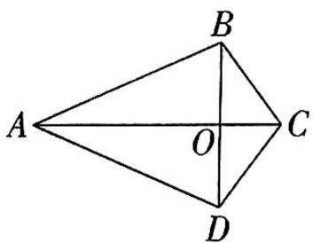
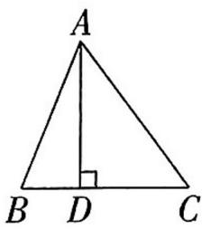

<!-- question-source:start -->
3[2025 河北唐山期中]对角线互相垂直的四边形叫作“垂美”四边形, 现有如图所示的“垂美”四边形 $ABCD$ , 对角线 $AC, BD$ 交于点 $O$ . 若 $AD = 4, BC = 2$ , 则 $AB^{2} + CD^{2} =$ \_\_\_\_.

(第3题图)

(第 4 题图)
<!-- question-source:end -->

![[Q00105107A1]]
