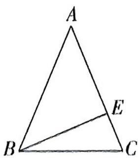

<!-- question-source:start -->
5[2025 山东烟台期中]如图, 在 $\triangle ABC$ 中, $AB = AC$ , 点 $E$ 在 $AC$ 上, $CE = 5$ , $BC = 13$ , $BE = 12$ .

(1) 判断 $\triangle ABE$ 的形状, 并说明理由;

(2) 求 $AB$ 的长.

建议用时 25 分钟 答案 D6
<!-- question-source:end -->

![[Q00105109A1]]
