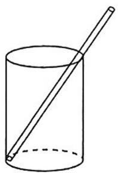
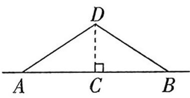

<!-- question-source:start -->
6[2024 广西桂林期中]如图所示,一根长为 $7 \, cm$ 的吸管放在一个圆柱形杯中,测得杯的内部底面直径为 $3 \, cm$ ,高为 $4 \, cm$ ,则吸管露在杯外面的最短长度为 \_\_\_\_ cm.

(第6题图)
(第7题图)
<!-- question-source:end -->

![[Q00105110A1]]
