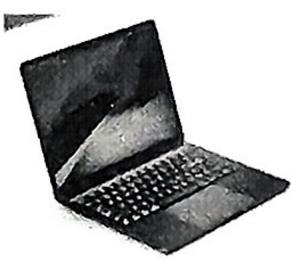
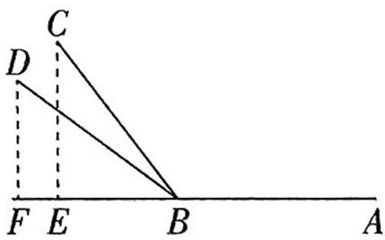

<!-- question-source:start -->
8[2025 四川成都期末]如图(1),一台笔记本电脑平放在水平桌面上,其示意图如图(2),屏幕宽BC为25 cm,当电脑张角为∠ABC时,顶部边缘C处到桌面的距离CE为20 cm,调整电脑的张角,当张角为∠ABD(点C与点D为笔记本顶部边缘同一点)时,顶部边缘D处到桌面的距离DF为15 cm,则E处与F处之间的距离EF长为\_\_\_\_cm.

图(1)

图(2)
<!-- question-source:end -->

![[Q00105112A1]]
