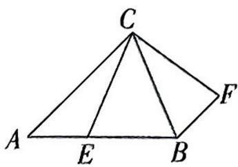
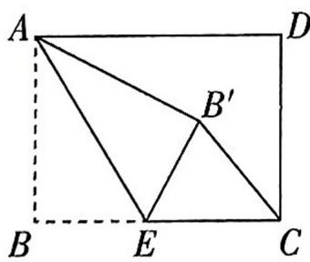

<!-- question-source:start -->
3 [2024 陕西中考, 中] 如图, 在 $\triangle ABC$ 中, $AB = AC$ , $E$ 是边 $AB$ 上一点, 连接 $CE$ , 在 $BC$ 的右侧作 $BF \parallel AC$ , 且 $BF = AE$ , 连接 $CF$ . 若 $AC = 13$ , $BC = 10$ , 则四边形 $EBFC$ 的面积为 \_\_\_\_.

(第3题图)

(第4题图)
<!-- question-source:end -->

![[Q00105116A1]]
