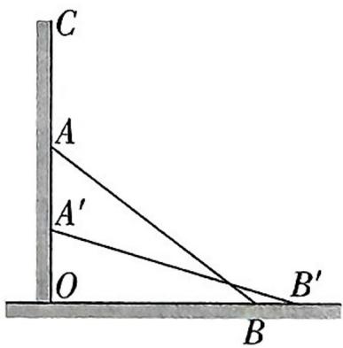

<!-- question-source:start -->

## 5 核心素养应用意识 [2025 广西防城港期中, 中]

【问题情境】消防云梯常用于高层建筑火灾等救援任务,它能让消防员快速到达高层救援现场.如图,已知一架云梯AB长25 m,斜靠在一面墙上,这时云梯底端与墙角的距离OB=20 m, $\angle AOB=90^{\circ}$ .

【独立思考】(1)求这架云梯顶部距离地面的高度 $OA$ .

【深入探究】(2) 消防员接到命令, 按要求将云梯从顶部 A 下滑到 $A'$ 位置上, 则底部 B 沿水平方向滑动到 $B'$ 位置上, 若 $AA' = 8 \, m$ , 求 $BB'$ 的长度.

【问题解决】(3)在演练中,墙边距地面24 m的窗口有求救声,消防员需调整云梯去救援被困人员.经验表明,云梯靠墙摆放时,如果云梯底端到墙的距离不小于云梯长度的 $\frac{1}{5}$ ,则云梯和消防员相对安全,在相对安全的前提下,云梯的顶端能否到达24 m高的窗口去救援被困人员?

电子错题本鸭
<!-- question-source:end -->

![[Q00105118A1]]
