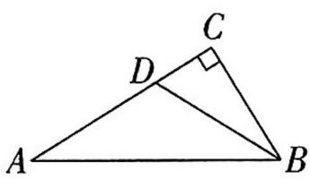
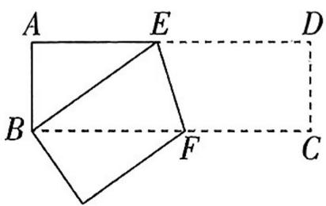

<!-- question-source:start -->
1. [2025 浙江温州期中]如图,在 Rt $\triangle ABC$ 中, $C=90^{\circ},D$ 为 AC 上一点,且 DA=DB=5,若 $\triangle ABD$ 的面积为 10,则 CD 的长为 ( )
A.3 B.4 C.5 D.4.5

(第1题图)

(第2题图)
<!-- question-source:end -->

![[Q00106326A1]]
