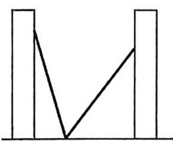
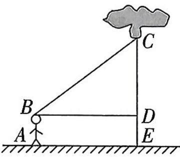

<!-- question-source:start -->
1. [2024 安徽淮南期末, 中] 如图, 小巷左右两侧是竖直的墙, 一架梯子斜靠在左墙时, 梯子底端到左墙角的距离为 $0.7 \mathrm{~m}$ , 顶端距离地面 $2.4 \mathrm{~m}$ . 如果保持梯子底端位置不动, 将梯子斜靠在右墙时, 顶端距离地面 $2 \mathrm{~m}$ , 则小巷的宽度为 ( ) A. $0.7 \mathrm{~m}$ B. $1.5 \mathrm{~m}$ C. $2.2 \mathrm{~m}$ D. $2.4 \mathrm{~m}$

(第1题图)

(第2题图)
<!-- question-source:end -->

![[Q00106328A1]]
