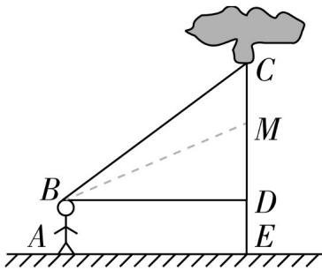
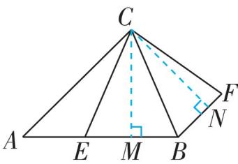

> [!success]- 必刷题
>
> > [!success] **【答案】** A
>
> > [!note]- **【解析】**
> > 因为 $BD \perp CE$ ，所以 $\angle BDC = 90^{\circ}$ .
> > 在Rt△CDB中，由勾股定理，得 $CD^{2} = BC^{2} - BD^{2} = 15^{2} - 12^{2} = 81$ ，所以 CD = 9 m。设风筝沿 CD 方向下降 4 m 至点 M，连接 BM，如图，则
> >
> > $CM = 4 \mathrm{~m}$ , 所以 $DM = CD - CM = 9 - 4 = 5(\mathrm{~m})$ , 所以 $BM^{2} = BD^{2} + DM^{2} = 12^{2} + 5^{2} = 169$ , 所以 $BM = 13 \mathrm{~m}$ , 所以 $BC - BM = 15 - 13 = 2(\mathrm{~m})$ , 即松松应该往回收线 $2 \mathrm{~m}$ , 故选 A. 公众号\*满满分享库
> >
> > 
> >
> > $$
> > A B = A C
> > $$
> >
> > $$
> > \angle A B C = \angle A C B
> > $$
> >
> > $$
> > B F \parallel A C
> > $$
> >
> > $$
> > \angle C B F
> > $$
> >
> > $$
> > \angle A C B =
> > $$
> >
> > 
> >
> > $$
> > \angle A B C = \angle C B F
> > $$
> >
> > 所以 BC 平分 $\angle ABF$ . 如图, 过点 C 作 $CM \perp AB$ 于点 M, $CN \perp BF$ 于点 N, 则 CM = CN. 因为 $S_{\triangle ACE} = \frac{1}{2} AE \cdot CM, S_{\triangle CBF} = \frac{1}{2} BF \cdot CN$ , 且 BF = AE, 所以 $S_{\triangle CBF} = S_{\triangle ACE}$ , 所以四边形 EBFC 的面积为 $S_{\triangle CBF} + S_{\triangle CBE} = S_{\triangle ACE} + S_{\triangle CBE} = S_{\triangle CBA}$ . 因为 AC = 13, 所以 AB = 13. 设 AM = x, 则 BM = 13 - x. 由勾股定理, 得 $CM^{2} = AC^{2} - AM^{2} = BC^{2} - BM^{2}$ , 所以 $13^{2} - x^{2} = 10^{2} - (13 - x)^{2}$ , 解得 $x = \frac{119}{13}$ , 所以 $CM^{2} = 13^{2} - \left(\frac{119}{13}\right)^{2} = \frac{14400}{169}$ , 所以 $CM = \frac{120}{13}$ , 所以 $S_{\triangle CBA} = \frac{1}{2} AB \cdot CM = 60$ , 所以四边形 EBFC 的面积为 60. 故答案为 60.
