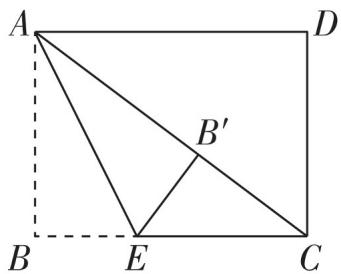
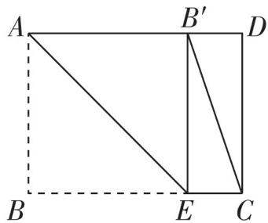

> [!success]- 必刷题
>
> > [!success] **【答案】** $\frac{3}{2}$ 或 3
>
> > [!note]- **【解析】**
> > 当 $\triangle CEB'$ 为直角三角形时,有以下两种情况: ①当 $\angle CB'E=90^{\circ}$ 时,如图(1)所示,连接AC. 在Rt $\triangle ABC$ 中, $AB=3,BC=4$ ,所以 $AC^{2}=4^{2}+3^{2}=25$ ,则AC=5.因为 $\angle B$ 沿AE折叠,使点B落在点 $B'$ 处,所以 $\angle AB'E=\angle B=90^{\circ}$ .又因为 $\angle CB'E=90^{\circ}$ ,所以点A, $B'$ ,C共线,即 $\angle B$ 沿AE折叠,使点B落在对角线AC上的点 $B'$ 处,则 $EB=EB',AB=AB'=3$ ,所以 $CB'=5-3=2$ .设 $BE=EB'=x$ ,则CE=4-x.在Rt $\triangle CEB'$ 中,因为 $EB'^{2}+CB'^{2}=CE^{2}$ ,所以 $x^{2}+2^{2}=(4-x)^{2}$ ,解得 $x=\frac{3}{2}$ ,即 $BE=\frac{3}{2}$ .
> >
> > 
> > 图(1)
> >
> > 
> > 图(2)
> >
> > 思路分析
> > 分两种情形：
> > 如图（1）中，
> > 当 A, B', C 共
> > 线时， $\angle EB'C=90^{\circ}$ . 如图（2）
> > 中，当点 $B'$ 落
> > 在 AD 边上
> > 时， $\angle CEB' = 90^{\circ}$ ，分别求解
> > 即可.
> >
> > 思路分析
> > 由勾股定理求出 BE 的长，
> > 设 AD = x，由折叠的性质得 $A'D = AD = x$ , $A'E = AE = 3$ 得到 $BA' = 2$ ,
> > BD = 4 - x，在
> > Rt $\triangle A'DB$ 中，
> > 由勾股定理，
> > 求出 x 的值即可.
> > - **②**：当点 $B'$ 落在 $AD$ 边上时, 如图(2)所示. 易知此时四边形 $ABEB'$ 为正方形, $\angle CEB' = 90^\circ$ , 所以 $BE = AB = 3$ . 综上所述, $BE$ 的长为 $\frac{3}{2}$ 或 3. 故答案为 $\frac{3}{2}$ 或 3.
> >
> > ## 刷素养·
