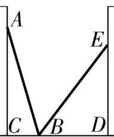

> [!success]- 必刷题
>
> > [!success] **【答案】** C
>
> > [!note]- **【解析】**
> > 如图, 由题意知 $\angle ACB = \angle BDE = 90^{\circ}, CB = 0.7 \mathrm{~m}, AC = 2.4 \mathrm{~m}, DE = 2 \mathrm{~m}$ . 在 Rt△ABC 中, $AB^{2} = AC^{2} + BC^{2} = 2.4^{2} + 0.7^{2} = 6.25$ , 所以 $AB = 2.5 \mathrm{~m}$ . 因为 $AB = BE$ , 所以 $BE = 2.5 \mathrm{~m}$ , 所以 $BD^{2} = BE^{2} - DE^{2} = 2.5^{2} - 2^{2} = 2.25$ , 所以 $BD = 1.5 \mathrm{~m}$ , 所以 $CD = CB + BD = 0.7 + 1.5 = 2.2 (\mathrm{~m})$ , 即小巷的宽度为 $2.2 \mathrm{~m}$ . 故选 C.
> >
> > 
