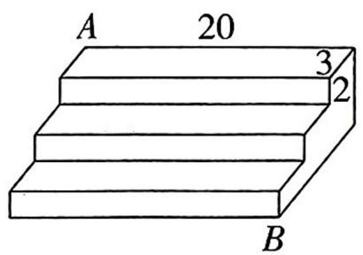
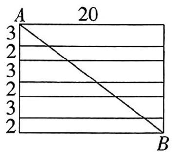
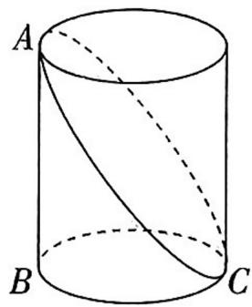
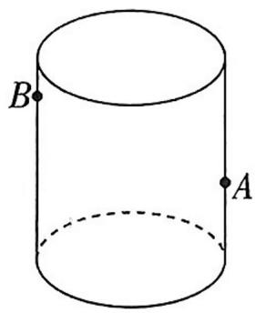

## ☆问题解决策略：反思

## 刷提升

建议用时 15 分钟 答案 D8

[2025 山东威海期中,较难]【问题情境】

数学综合与实践活动课上,老师提出如下问题:一个三级台阶,它每一级的长、宽、高分别为 20 dm, 3 dm, 2 dm, A 和 B 是一个三级台阶上两个相对的端点.

## 【探究实践】

老师让同学们探究:如图(1),若A点处有一只蚂蚁要到B点去吃食物,则蚂蚁沿着台阶爬到B点的最短路程是多少?

(1)同学们经过思考得到如下解题方法:如图(2)为三级台阶的平面展开图,可得到长为 $20 \, dm$ , 宽为 $15 \, dm$ 的长方形, 连接 AB, 经过计算得到 AB 的长度为 \_\_\_\_, 就是最短路程.

## 【变式探究】

(2)如图(3),已知圆柱底面的周长为 $6 \mathrm{dm}$ , 圆柱高为 $4 \mathrm{dm}$ , 在圆柱的侧面有一只蚂蚁, 从点 $A$ 爬到点 $C$ , 再从点 $C$ 爬回点 $A$ , 恰好爬行一圈, 则这只蚂蚁爬行的最短路程为 \_\_\_\_.

图(1)

图(2)

图(3)

图(4)

## 【拓展应用】

(3)如图(4),圆柱形玻璃杯的高为 $9 \mathrm{~cm}$ ,底面周长为 $16 \mathrm{~cm}$ ,在杯内壁离杯底 $4 \mathrm{~cm}$ 的点 $A$ 处有一滴蜂蜜,此时,一只蚂蚁正好在外壁离杯口 $1 \mathrm{~cm}$ ,且与蜂蜜相对的点 $B$ 处,则蚂蚁从外壁 $B$ 处到内壁 $A$ 处所爬行的最短路程是多少? (杯壁厚度不计)

不愧是我鸦

是个新“烤”鸭

电子错题本鸭

## 届中考
