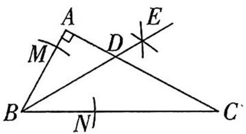
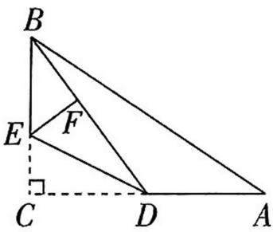

<!-- question-source:start -->
2[2023 江苏扬州中考]如图, $\triangle ABC$ 中, $\angle A = 90^{\circ}, AB = 8, AC = 15$ , 以点 $B$ 为圆心, 适当长为半径画弧, 分别交 $BA, BC$ 于点 $M, N$ , 再分别以点 $M, N$ 为圆心, 大于 $\frac{1}{2}MN$ 的长为半径画弧, 两弧交于点 $E$ , 作射线 $BE$ 交 $AC$ 于点 $D$ , 则线段 $AD$ 的长为 \_\_\_\_.

(第2题图)
(第3题图)
<!-- question-source:end -->

![[Q00105125A1]]
