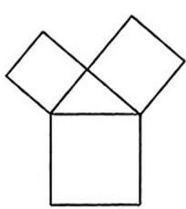
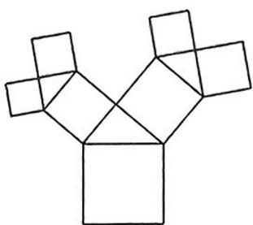
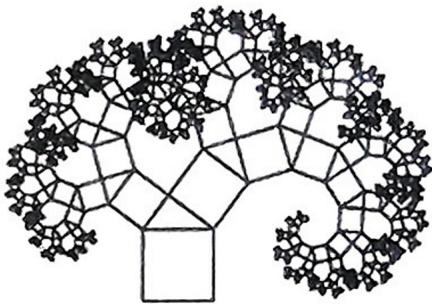

<!-- question-source:start -->
4[2024 黑龙江大庆中考]如图(1), 直角三角形的两个锐角分别是 $40^{\circ}$ 和 $50^{\circ}$ , 其三边上分别有一个正方形. 执行下面的操作: 由两个小正方形向外分别作锐角为 $40^{\circ}$ 和 $50^{\circ}$ 的直角三角形, 再分别以所得到的直角三角形的直角边为边长作正方形. 图(2)是1次操作后的图形. 图(3)是重复上述步骤若干次后得到的图形, 人们把它

建议用时 25 分钟

称为“毕达哥拉斯树”. 若图(1)中的直角三角形斜边长为 2, 则 10 次操作后图形中所有正方形的面积和为 \_\_\_\_.

图(1)
图(2)

图(3)
<!-- question-source:end -->

![[Q00105127A1]]
