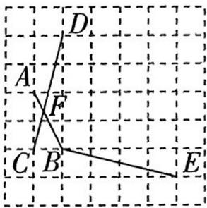

<!-- question-source:start -->
5[2023 山东济宁中考]如图,在正方形方格中,每个小正方形的边长都是一个单位长度,点A,B,C,D,E均在小正方形方

格的顶点上,线段 AB,CD 交于点 F,若 $\angle CFB = \alpha$ ,则 $\angle ABE$ 等于 ( )
A. $180^{\circ}-\alpha$ B. $180^{\circ}-2\alpha$ C. $90^{\circ}+\alpha$ D. $90^{\circ}+2\alpha$
<!-- question-source:end -->

![[Q00105128A1]]
