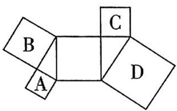
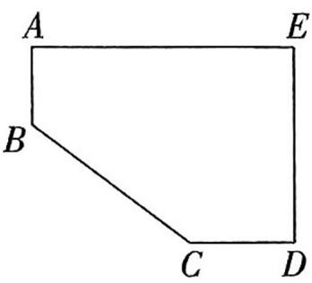

<!-- question-source:start -->
1 [2025 江苏无锡期中] 如图, 所有四边形都是正方形, 所有三角形都是直角三角形, 若正方形 A, B, C 的面积依次为 2, 6, 3, 则正方形 D 的面积为 ( )
A. 6    B. 8    C. 11    D. 12

(第1题图)
(第2题图)
<!-- question-source:end -->

![[Q00105130A1]]
