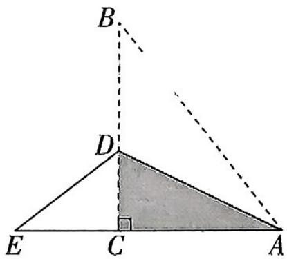

<!-- question-source:start -->
3[2025 山东青岛期末]如图,将直角三角形纸片 $A B C$ 沿 $A D$ 折叠,使点 $B$ 落在 $A C$ 延长线上的点 $E$ 处. 若 $A C = 3, B C = 4$ , 则图中阴影部分的面积是 ( )

A. $\frac{3}{4}$ B. $\frac{9}{4}$ C. $\frac{3}{2}$ D. $\frac{9}{2}$
<!-- question-source:end -->

![[Q00105132A1]]
