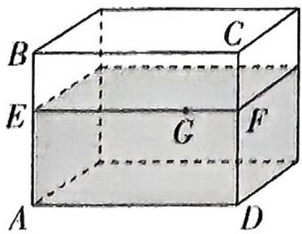

<!-- question-source:start -->
4 如图所示的长方体透明玻璃鱼缸, 假设其长 $AD = 80 \mathrm{~cm}$ , 高 $AB = 60 \mathrm{~cm}$ , 水深 $AE = 40 \mathrm{~cm}$ . 在水面上紧贴内壁 $G$ 处有一块面包屑, $G$ 在水面线 $EF$ 上, 且 $EG = 60 \mathrm{~cm}$ , 一只蚂蚁想从鱼缸外的 $A$ 点沿鱼缸壁爬进鱼缸内的 $G$ 处吃面包屑, 则蚂蚁爬行的最短路线长为 \_\_\_\_ cm.

<!-- question-source:end -->

![[Q00105133A1]]
