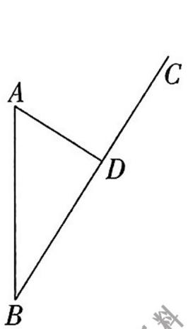

<!-- question-source:start -->
6[2025 四川成都期中]如图,某沿海城市 A 接到台风预警,在该市正南方向 340 km 的 B 处有一台风中心,沿 BC 方向以 15 km/h 的速度移动,已知城市 A 到 BC 的距离 AD 为 160 km.
(1) 台风中心经过多长时间从 B 点移到 D 点?
(2) 如果在距台风中心 200 km 的圆形区域内都将受到台风的影响,那么 A 市受到台风影响的时间持续多少小时?

<!-- question-source:end -->

![[Q00105135A1]]
