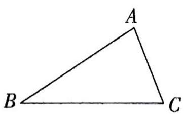
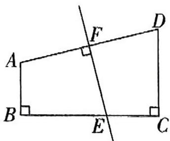

<!-- question-source:start -->
7[2024 江苏苏州吴江区质检]定义:在一个图形上画一条直线,若这条直线既平分该图形的面积,又平分该图形的周长,我们称这条直线为这个图形的“等分积周线”.

(1)如图(1),已知 $\triangle ABC,AC \neq BC$ ,过点 $C$ 能否画出 $\triangle ABC$ 的一条“等分积周线”？若能,说出确定的方法;若不能,请说明理由.

(2)如图(2),在四边形ABCD中, $\angle B=\angle C=90^{\circ}$ ,EF垂直平分AD,垂足为F,交BC于点E,已知AB=3,BC=8,CD=5.试说明:直线EF为四边形ABCD的“等分积周线”.

图(1)

图(2)
<!-- question-source:end -->

![[Q00105136A1]]
