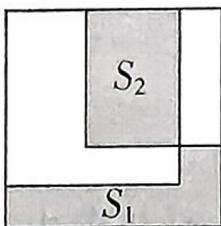

<!-- question-source:start -->
1. [2023 山东日照中考]已知直角三角形的三边 $a, b, c$ 满足 $c > a > b$ , 分别以 $a, b, c$ 为边作三个正方形, 把

两个较小的正方形放置在最大正方形内,如图,设三个正方形无重叠部分的面积为 $S_{1}$ , 均重叠部分的面积为 $S_{2}$ , 则 ( )
A. $S_{1} > S_{2}$ B. $S_{1} < S_{2}$ C. $S_{1} = S_{2}$ D. $S_{1}, S_{2}$ 大小无法确定
<!-- question-source:end -->

![[Q00106330A1]]
