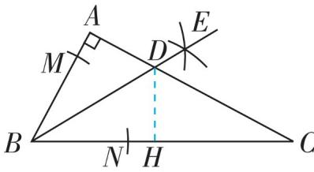

> [!success]- 必刷题
>
> > [!success] **【答案】** $\frac{24}{5}$
>
> > [!note]- **【解析】**
> > 如图, 过点 $D$ 作 $DH \perp BC$ 于点 $H$ . 由题意可得, $BE$ 为
> >
> > 
> >
> > $\angle ABC$ 的平分线. 在 $\triangle ABC$ 中, $\angle A = 90^{\circ}$ , $AB = 8$ , $AC = 15$ , 所以 $BC^{2} = AB^{2} + AC^{2} = 8^{2} + 15^{2} = 289$ , 所以 $BC = 17$ . 因为 $BE$ 平分 $\angle ABC$ , $DA \perp AB$ , $DH \perp BC$ , 所以 $DA = DH$ . 因为 $S_{\triangle ABC} = S_{\triangle ABD} + S_{\triangle DCB}$ , 所以 $\frac{1}{2} \times 8 \times 15 = \frac{1}{2} \times 8 \times AD + \frac{1}{2} \times 17 \times DH$ , 所以 $AD = DH = \frac{24}{5}$ . 故答案为 $\frac{24}{5}$ .
