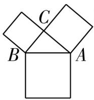

> [!success]- 必刷题
>
> > [!success] **【答案】** 48
>
> > [!note]- **【解析】**
> > 如图. 因为 $\angle ACB = 90^{\circ}$ , 根据勾股定理, 得 $AC^{2} + BC^{2} = AB^{2} = 2^{2} = 4$ , 所以题图 (1) 中所有
> >
> > 
> >
> > ## 刷有所得
> >
> > n 次操作后图形中所有正方形的面积和为题图(1)中正方形的面积和+4n.
> >
> > 正方形的面积和为 $4+4=8$ ，题图(2)中所有正方形的面积和，即1次操作后图形中所有正方形的面积和为 $8+4=12,2$ 次操作后图形中所有正方形的面积和为 $8+4\times2=16,3$ 次操作后图形中所有正方形的面积和为 $8+4\times3=20,\cdots$ ，所以 n 次操作后图形中所有正方形的面积和为 $8+4n$ ，所以10次操作后图形中所有正方形的面积和为 $8+4\times10=48$ 。
