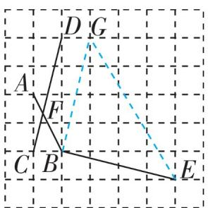

> [!success]- 必刷题
>
> > [!success] **【答案】** C
>
> > [!note]- **【解析】**
> > 如图, 过 B 点作 $BG \parallel CD$ , 连接 EG。因为 $BG \parallel CD$ , 所以 $\angle ABG = \angle CFB = \alpha$ . 因为 $BG^{2} = 1^{2} + 4^{2} = 17$ , $BE^{2} = 1^{2} + 4^{2} = 17$ , $EG^{2} = 3^{2} + 5^{2} = 34$ , 所以 $BG^{2} + BE^{2} = EG^{2}$ , 所以 $\triangle BEG$ 是直角三角形, 所以 $\angle GBE = 90^{\circ}$ , 所以 $\angle ABE = \angle GBE + \angle ABG = 90^{\circ} + \alpha$ . 故选 C.
> >
> > 
