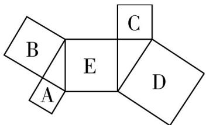

> [!success]- 必刷题
>
> > [!success] **【答案】** C
>
> > [!note]- **【解析】**
> > 如图, 设正方形 A, B, C, D 的边长分别为 a, b, c, d, 正方形 E 的边长为 x. 因为所有三角形都为直角三角形, 所以 $a^{2} + b^{2} = x^{2}$ , $x^{2} + c^{2} = d^{2}$ , 所以 $d^{2} = a^{2} + b^{2} + c^{2}$ . 因为正方形 A, B, C 的面积依次为 2, 6, 3, 所以 $d^{2} = 2 + 6 + 3 = 11$ , 所以正方形 D 的面积为 11. 故选 C.
> >
> > 
