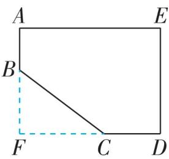

> [!success]- 必刷题
>
> > [!success] **【答案】** C
>
> > [!note]- **【解析】**
> > 如图, 延长 $AB, DC$ 相交于 $F$ , 则 $\triangle BFC$ 是直角三角形. 由勾股定理得 $BF^{2} + FC^{2} = BC^{2}$ . 因为 $AB = 6 \mathrm{~cm}, CD = 8 \mathrm{~cm}, AF = 15 \mathrm{~cm}, FD = 20 \mathrm{~cm}$ , 所以 $BC^{2} = (15 - 6)^{2} + (20 - 8)^{2} = 9^{2} + 12^{2} = 225$ , 所以 $BC = 15 \mathrm{~cm}$ . 故选 C.
> >
> > 
> >
> > 
