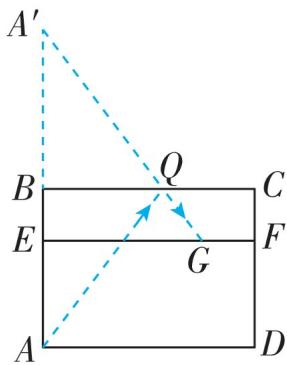
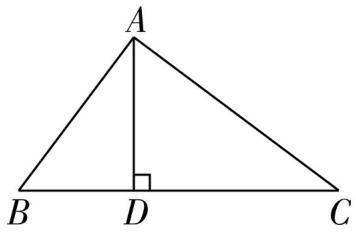
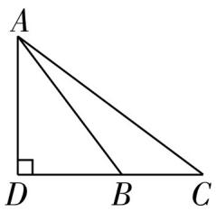

> [!success]- 必刷题
>
> > [!success] **【答案】** 100
>
> > [!note]- **【解析】**
> > 如图,作点 A 关于 BC 的对称点 $A'$ , 连接 $A'G$ 交 BC 于点 Q, 则 $AQ + QG = A'Q + QG = A'G$ , 所以蚂蚁沿着 $A \rightarrow Q \rightarrow G$ 的路线爬
> >
> > 
> >
> > 行时路程最短, 最短路程等于 $A'G$ 的长. 在 Rt $\triangle A'EG$ 中, $A'E = 80 \mathrm{~cm}, EG = 60 \mathrm{~cm}$ , 所以 $A'G^{2} = A'E^{2} + EG^{2} = 10000$ , 所以 $A'G = 100 \mathrm{~cm}$ , 所以最短路线长为 $100 \mathrm{~cm}$ . 故答案为 100.
> >
> > 初中必刷题 数学八年级上册 BS
> >
> > 5.25 或 7 【解析】如图(1), 当点 $D$ 在线段 $BC$ 上时, 因为 $AD = 12$ , $BD = 9$ , $AB = 15$ , 所以 $AD^{2} + BD^{2} = AB^{2}$ , 所以 $\triangle ABD$ 是直角三角形, 且 $\angle ADB = 90^{\circ}$ , 所以 $\angle ADC = 90^{\circ}$ , 所以 $DC^{2} = AC^{2} - AD^{2} = 20^{2} - 12^{2} = 256$ , 所以 $DC = 16$ , 所以 $BC = BD + CD = 9 + 16 = 25$ ; 如图(2), 当点 $D$ 在 $CB$ 的延长线上时, 同理可得 $DC = 16$ , 所以 $BC = CD - BD = 16 - 9 = 7$ . 因为 $AC > AB$ , 所以点 $D$ 不在 $BC$ 的延长线上. 综上所述, $BC$ 的长度为 25 或 7. 故答案为 25 或 7.
> >
> > 
> > 图(1)
> >
> > 
> > 图(2)
