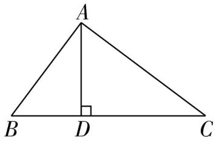
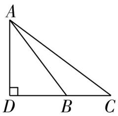

> [!success]- 必刷题
>
> > [!success] **【答案】** C
>
> > [!note]- **【解析】**
> > 无理数包括正无理数和负无理数，故 A 错误；无限循环小数是有理数，无限不循环小数是无理数，故 B 错误；实数可分为正实初中必刷题 数学八年级上册 BS
> >
> > 5.25 或 7 【解析】如图(1), 当点 $D$ 在线段 $BC$ 上时, 因为 $AD = 12$ , $BD = 9$ , $AB = 15$ , 所以 $AD^{2} + BD^{2} = AB^{2}$ , 所以 $\triangle ABD$ 是直角三角形, 且 $\angle ADB = 90^{\circ}$ , 所以 $\angle ADC = 90^{\circ}$ , 所以 $DC^{2} = AC^{2} - AD^{2} = 20^{2} - 12^{2} = 256$ , 所以 $DC = 16$ , 所以 $BC = BD + CD = 9 + 16 = 25$ ; 如图(2), 当点 $D$ 在 $CB$ 的延长线上时, 同理可得 $DC = 16$ , 所以 $BC = CD - BD = 16 - 9 = 7$ . 因为 $AC > AB$ , 所以点 $D$ 不在 $BC$ 的延长线上. 综上所述, $BC$ 的长度为 25 或 7. 故答案为 25 或 7.
> >
> > 
> > 图(1)
> >
> > 
> > 图(2)
