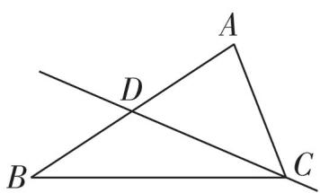
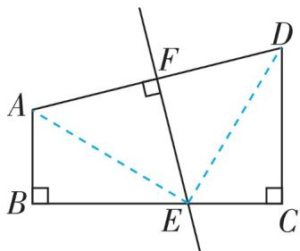
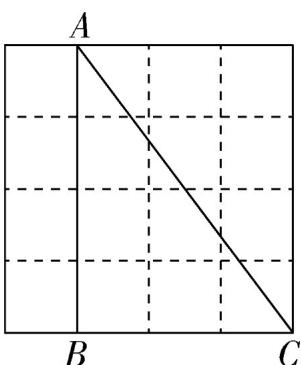
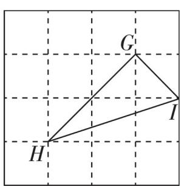

> [!success]- 必刷题
>
> > [!success] **【答案】** 详见解析
>
> > [!note]- **【解析】**
> > 【解】(1)不能,理由:如图(1),若直线 CD 平分△ABC 的面积,则 $S_{\triangle ADC} = S_{\triangle DBC}$ , 所以 AD = BD. 因为 $AC \neq BC$ , 所以 $AD + AC \neq BD + BC$ , 所以直线 CD 不平分△ABC 的周长, 所以过点 C 不能画出△ABC 的一条“等分积周线”.
> >
> > 一些比较繁琐的小数容易误判为无理数，例如：
> >
> > 
> > 图(1)
> >
> > 
> > 图(2)
> >
> > (2)如图(2)，连接 $AE, DE$ ，设 $BE = x$ . 因为 $EF$ 垂直平分 $AD$ ，所以 $AE = DE, AF = DF$ ，所以 $S_{\triangle AEF} = S_{\triangle DEF}$ . 因为 $\angle B = \angle C = 90^{\circ}, AB = 3, BC = 8, CD = 5$ ，所以在 Rt $\triangle ABE$ 和 Rt $\triangle DCE$ 中，根据勾股定理可得出 $AB^{2} + BE^{2} = CE^{2} + DC^{2}$ ，即 $3^{2} + x^{2} = (8 - x)^{2} + 5^{2}$ ，解得 $x = 5$ ，所以 $BE = 5, CE = 3$ ，所以 $AB + BE = CE + DC, S_{\triangle ABE} = S_{\triangle DCE}$ . 因为 $S_{\text{四边形} ABEF} = S_{\triangle ABE} + S_{\triangle AEF}, S_{\text{四边形} DCEF} = S_{\triangle DEF} + S_{\triangle DCE}$ ，所以 $S_{\text{四边形} ABEF} = S_{\text{四边形} DCEF}, AF + AB + BE = DF + EC + DC$ ，所以直线 $EF$ 为四边形 ABCD 的“等分积周线”.
> >
> > 
> > 图(1)
> >
> > 
> > 图(2)
