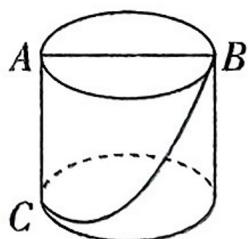

## 全章综合训练 刷中考

![[初中/课堂同步/教辅/必刷题/2026 八上必刷题 北师大数学/01_第一章_勾股定理/全章综合训练/questions/Q00106330.md]]
![[初中/课堂同步/教辅/必刷题/2026 八上必刷题 北师大数学/01_第一章_勾股定理/全章综合训练/questions/Q00105125.md]]
![[初中/课堂同步/教辅/必刷题/2026 八上必刷题 北师大数学/01_第一章_勾股定理/全章综合训练/questions/Q00105126.md]]
![[初中/课堂同步/教辅/必刷题/2026 八上必刷题 北师大数学/01_第一章_勾股定理/全章综合训练/questions/Q00105127.md]]

## 考点 2 直角三角形判定的应用

![[初中/课堂同步/教辅/必刷题/2026 八上必刷题 北师大数学/01_第一章_勾股定理/全章综合训练/questions/Q00105128.md]]

## 考点3 勾股数

![[初中/课堂同步/教辅/必刷题/2026 八上必刷题 北师大数学/01_第一章_勾股定理/全章综合训练/questions/Q00105129.md]]

## 考点4 勾股定理的应用

![[初中/课堂同步/教辅/必刷题/2026 八上必刷题 北师大数学/01_第一章_勾股定理/全章综合训练/questions/Q00106331.md]]
