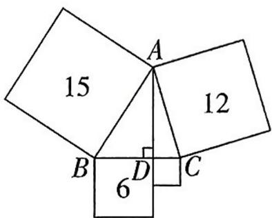
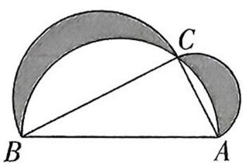

<!-- question-source:start -->
5[2024 浙江台州调研]如图, $AD$ 是 $\triangle ABC$ 的高,分别以 $AB, BD, DC, CA$ 为边向外作正方形,其中3个正方形的面积如图所示,则第四个正方形的面积为 ( )
A. 1 B. 2 C. 3 D. 4

建议用时 20 分钟 答案

(第5题图)

(第6题图)
<!-- question-source:end -->

![[Q00105071A1]]
