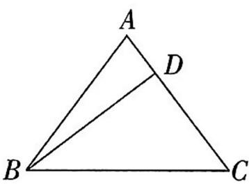
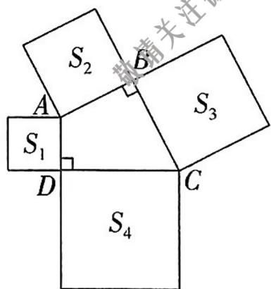

<!-- question-source:start -->
7 [2024 北京海淀区期中] 如图, 在 $\triangle ABC$ 中, $AB = AC = 5, BC = 6$ , 则 $AC$ 边上的高 $BD$ 的长为 ( ) A. 4 B. 4. 4 C. 4. 8 D. 5

(第7题图)

(第8题图)
<!-- question-source:end -->

![[Q00105073A1]]
