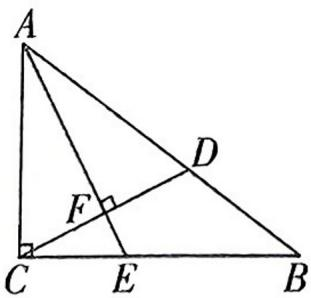
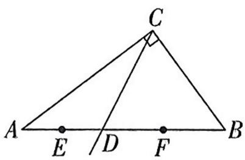

<!-- question-source:start -->
4[2025 四川成都质检, 中]如图, 在 $\triangle ABC$ 中, $\angle ACB = 90^{\circ}, AC = 3, BC = 4$ , 点 $D$ 在边 $AB$ 上, $AD = AC, AE \perp CD$ , 交 $BC, CD$ 于点 $E, F$ , 则 $BE$ 的长是 \_\_\_\_.

(第4题图)

(第5题图)
<!-- question-source:end -->

![[Q00105079A1]]
