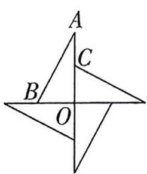
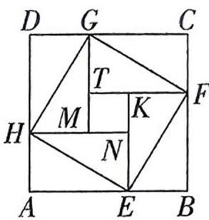

<!-- question-source:start -->
6 [2025 陕西西安质检, 中] 探究:

(1) 图(1)是由四个全等的直角三角形紧密拼接形成的飞镖状图形, 若 $AB + AC = 20$ , $OC = 5$ , 求该飞镖状图形的面积.

(2)图(2)是由八个全等的直角三角形紧密拼接形成的大正方形 $ABCD$ , 记图中正方形 $ABCD$ , 正方形 $EFGH$ , 正方形 $MNKT$ 的面积分别为 $S_{1}, S_{2}, S_{3}$ . 若 $S_{2} = 6$ , 求 $S_{1} + S_{3}$ 的值.

图(1)

图(2)
<!-- question-source:end -->

![[Q00105082A1]]
